# PoraBondhu AI (পড়াবন্ধু AI)

A Bangla reading diagnostician for primary teachers. A child reads a short passage
aloud; PoraBondhu marks every word (correct, misread, skipped, unsure), traces each
error to the Bangla written unit behind it (যুক্তাক্ষর, কার, ফলা, রেফ, চন্দ্রবিন্দু),
and tells the teacher which patterns each child needs next. The teacher can
correct any mark with one tap.

**Everything runs on a CPU, with no language-model API.** Run locally, no audio
leaves the computer. In the live demo, audio goes over HTTPS only to our own
rented server (a 2-core Ubuntu VPS running this repository's Docker image) and is
never sent to a third-party AI service.

| | |
|---|---|
| **Event** | CoU AI Hackathon 2026, Comilla University |
| **Team** | Twin logic (duo) |
| **Members** | Md Yak Safu · Munny Rahaman Dristy. Md Yak Safu designed, built and committed the project; Munny Rahaman Dristy was unable to take part in the build |
| **Domain** | Education (primary), Accessibility (secondary) |
| **Live demo** | **https://porabondhu.165-99-219-251.sslip.io** (HTTPS only; the app port is reachable only through the HTTPS proxy) |
| **Demo video** | **https://youtu.be/z_jiGV3ZkbU** (2:00, Bangla narration with a cartoon guide; a narrated walkthrough of real screenshots of the app, not a live screen recording). Live steps: [5-minute demo script](#demo-in-5-minutes) |
| **Repository** | https://github.com/mohammadyaksafu/porabondhu-ai |
| **Docs** | [Teacher guide](docs/TEACHER_GUIDE.md) · [Children's data and security](docs/DATA_PROTECTION.md) · [Teacher usability test (not run yet)](docs/USABILITY_TEST.md) · [Curriculum alignment](docs/CURRICULUM_ALIGNMENT.md) · [Classroom workflow, pilot plan, safeguards and interview questions](docs/CLASSROOM_AND_PILOT.md) · [Technical defence and demo script](docs/TECHNICAL_DEFENSE.md) · [Data collection](docs/DATA_COLLECTION.md) |

### Test logins for the live demo

> **Testing only.** These logins are public, so anyone can see what is recorded on the demo
> server. **Do not record or upload real children's voices there**; read the passages in your own
> voice. The app shows the same warning on the login, assessment and recording screens.

| Role | Username | Password |
|---|---|---|
| Admin (creates teacher accounts; Teacher tab) | `admin` | `admin123` |
| Teacher | `teacher` | `teacher123` |
| Student (class 3, roll 01) | `c3r01` | `student123` |

Any student `c1r01` … `c5r10` works with `student123`. The demo classes include
**simulated practice history** (generated by `backend/app/seed/demo.py` and run
through the real marking engine, saved with model id `demo-seed (simulated)`,
no audio) so the dashboards are not empty. Every simulated reading is labelled
**DEMO · simulated** in the app, and the dashboard shows how many there are. Every new reading you record is
marked live by the real models. The first reading after a restart takes longer
while the models load.

### Demo in 5 minutes

**Real vs simulated:** everything you record in the demo is marked live by the real speech model on
the server's CPU. The older history in the dashboards (badge **DEMO · simulated**) was generated from
scripted errors so the screens are not empty; it is not model output on real children. Marking a
reading takes time (about 18-20 s for a 60 s reading on our 4-core laptop, longer on the 2-core
server); the progress bar shows the real stages, so do not cut the wait out of a recording.

| Step | Where | What to show |
|---|---|---|
| 1 | Log in as `teacher` | Dashboard: the **DEMO** banner says how many readings are simulated |
| 2 | **Class 2** (or create a class: **+ New class**, then **Add students**) | Class pattern map: which units (র-ফলা, কার, যুক্তাক্ষর) most children misread |
| 3 | **Assess a child** → Roll 01 → passage **T06** (ফলা lesson, NCTB Class 2 p. ২৩-২৪) | Read it aloud in **your own voice**, making two slips (স্মরণ → সরণ, দ্বিতীয় → দিতীয়). Watch the progress bar show the real pipeline stages |
| 4 | **Review** | Click a red word: heard vs expected unit by unit, play just that word. Change one mark with a tap, then **Finalise review** (audio is deleted unless "Keep the audio" is ticked) |
| 5 | Student page → **Assign practice** on a weak pattern | Words and a passage containing that unit are picked for the child |
| 6 | Log out, log in as `c2r01` / `student123` | The checked reading now shows its mark; an unchecked one says "your teacher will check". **From your teacher** shows the assigned words with a **Say it** check |
| 7 | Teacher → **Benchmark** | The 100-recording held-out comparison (adult FLEURS speech, simulated errors): PoraBondhu vs plain CTC vs Whisper, paired differences, robustness checks including the child-like voice failure, and the missed targets |
| 8 | Teacher → **Settings** → **Reset demo recordings** | Clean up for the next visitor |

**Recording checklist for a live screen-recorded video (3 minutes max), if you make one:** use the HTTPS link in Chrome or
Edge on a laptop; allow the microphone; use a headset in a quiet room; read in your own
voice (no children); show steps 1, 3, 4, 6 and 7; keep the DEMO badges visible so simulated
data is never presented as real; do not cut the waiting time to make marking look faster;
finish with **Reset demo recordings**.

**Reset demo recordings** (Settings, teacher only, demo server only) permanently deletes every
reading recorded on the server, its audio, any leftover audio files and all assigned practice.
The simulated history and the logins stay. It is disabled when `PB_SEED_DEMO=false`.

**Check the live link yourself** (from a network without TLS inspection, e.g. mobile data):
open the HTTPS link, click the padlock (the certificate should be issued by Let's Encrypt), log
in as `teacher`, start a reading and allow the microphone. `https://<host>/api/health` should
return HTTP 200 with `"ok": true` (builds from this commit on also report `"demo_mode": true`). Some campus networks (e.g. a FortiGate firewall)
replace the certificate and the browser warns; that is the network, not the server.

### Real school installation (no demo accounts)

Set `PB_SEED_DEMO=false` in `backend/.env` before the first start (no public logins, no
simulated data, no demo reset), set `PB_AUDIO_RETENTION_DAYS=14`, then create the teacher
login: `python -m scripts.create_teacher <username>` (asks for an 8+ character password). See
[docs/TEACHER_GUIDE.md](docs/TEACHER_GUIDE.md), [docs/DATA_PROTECTION.md](docs/DATA_PROTECTION.md)
(who can see recordings, consent and withdrawal, deletion, storage) and, before recording any child, the safeguards in
[docs/CLASSROOM_AND_PILOT.md](docs/CLASSROOM_AND_PILOT.md#7-safeguards-required-before-any-real-child-pilot).

## Screenshots (the real app)

Captured on 23 Nov 2026 from this repository running locally with the demo data; readings marked
**DEMO · simulated** are generated practice history, everything else is real model output. Full
step-by-step guide: [docs/WALKTHROUGH.md](docs/WALKTHROUGH.md).

<table>
<tr><td width="50%" valign="top">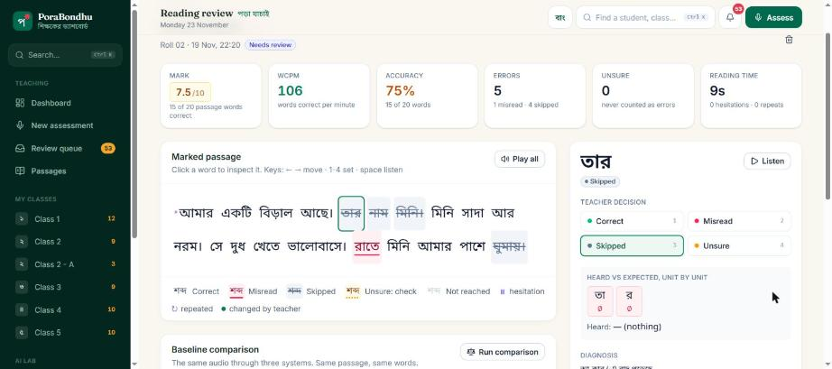<br><sub>Teacher review: every word marked; click a word to see heard vs expected unit by unit, the diagnosis and the evidence; one tap changes a mark</sub></td><td width="50%" valign="top">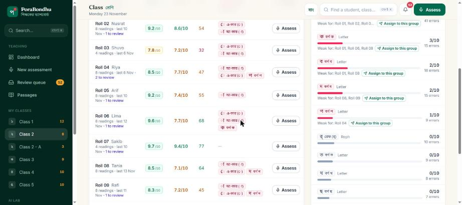<br><sub>Class pattern map: which written units the class misreads, and "Assign to this group"</sub></td></tr>
<tr><td width="50%" valign="top">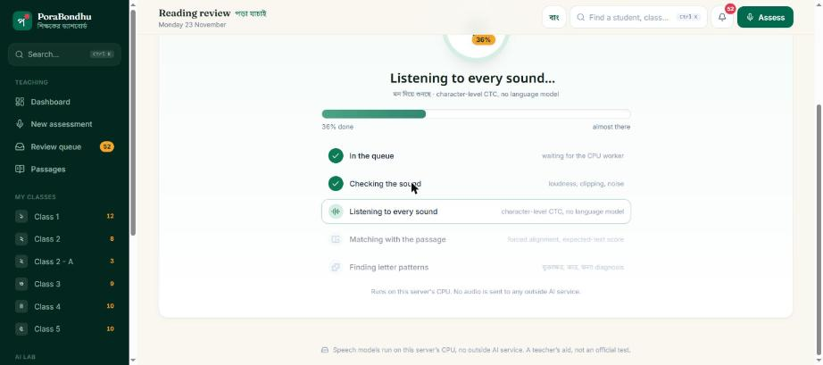<br><sub>Real marking stages while the model works (no fake spinner)</sub></td><td width="50%" valign="top">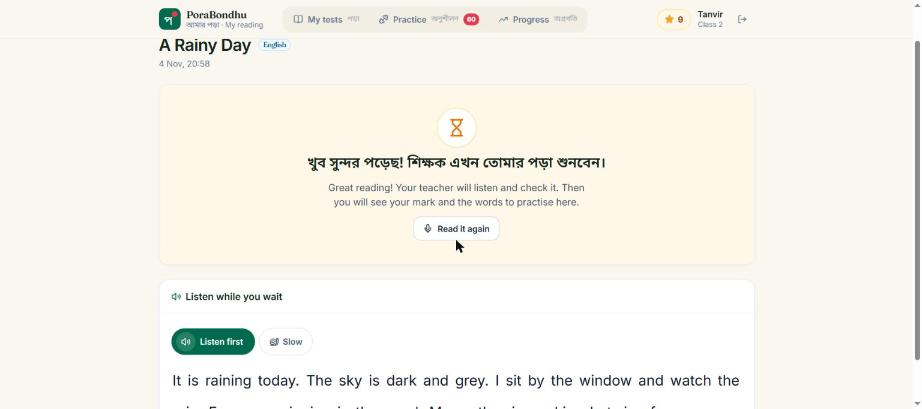<br><sub>Child sees no mark until the teacher has checked the reading</sub></td></tr>
<tr><td width="50%" valign="top">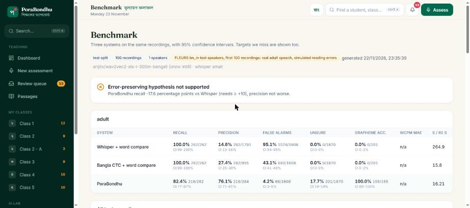<br><sub>Benchmark page: 100 held-out recordings, three systems, confidence intervals, missed targets</sub></td><td width="50%" valign="top">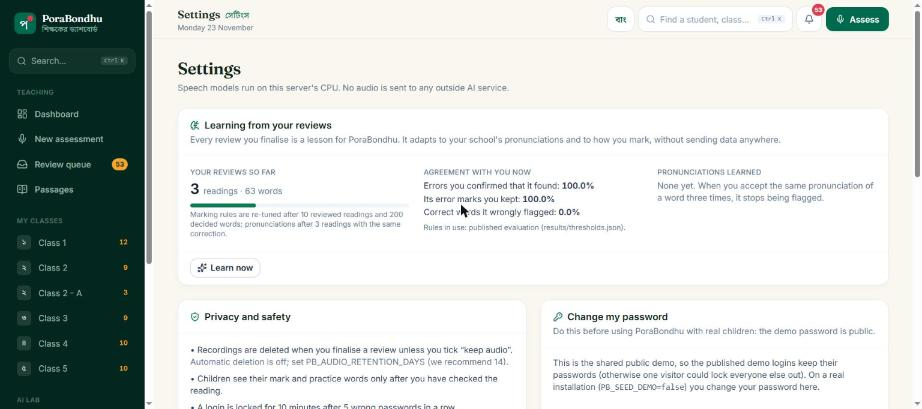<br><sub>Learning from teacher reviews, privacy rules, password, demo reset</sub></td></tr>
</table>

<details>
<summary><b>Teacher site, all 18 steps</b></summary>

<table>
<tr><td width="50%" valign="top">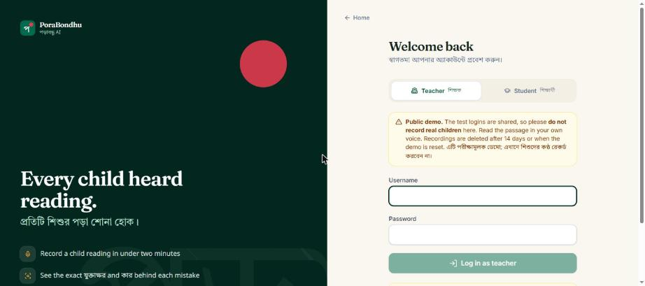<br><sub>1. Login (public-demo warning)</sub></td><td width="50%" valign="top">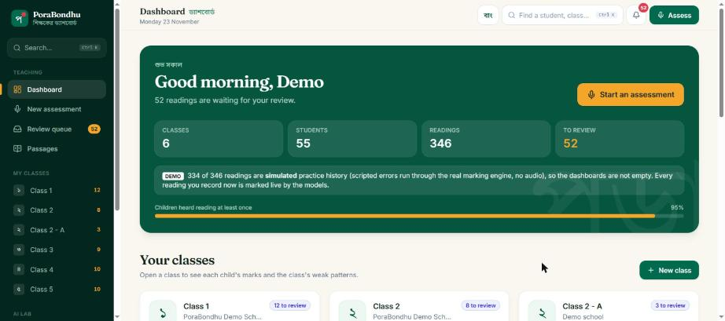<br><sub>2. Dashboard (simulated data labelled DEMO)</sub></td></tr>
<tr><td width="50%" valign="top">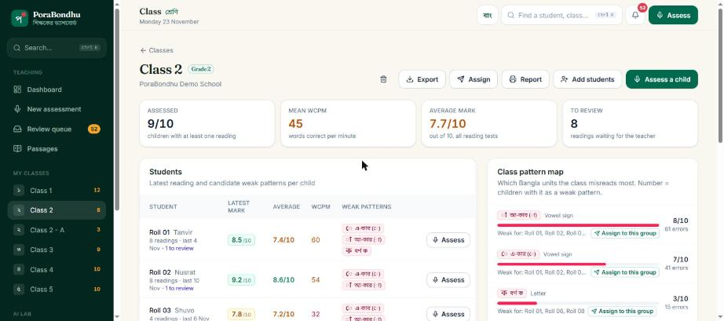<br><sub>3. Class: marks, speed, weak patterns, Export / Assign / Report</sub></td><td width="50%" valign="top"><br><sub>4. Class pattern map</sub></td></tr>
<tr><td width="50%" valign="top">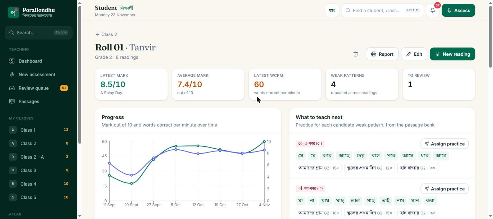<br><sub>5. Student: progress and what to teach next</sub></td><td width="50%" valign="top">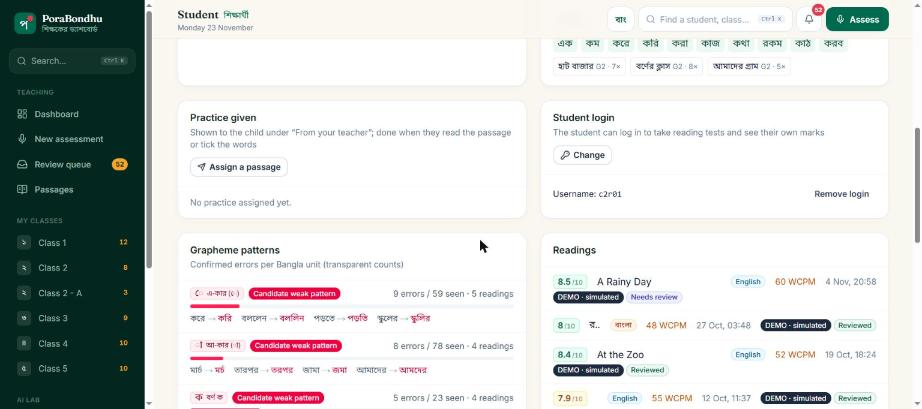<br><sub>6. Practice given, student login, grapheme patterns, readings</sub></td></tr>
<tr><td width="50%" valign="top">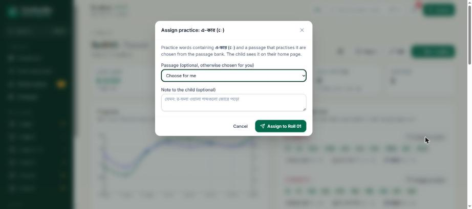<br><sub>7. Assign practice for a weak pattern</sub></td><td width="50%" valign="top">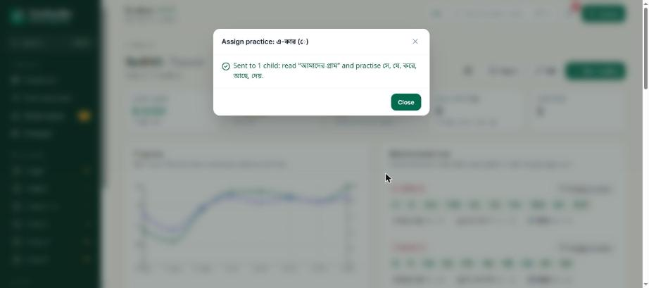<br><sub>8. Practice sent</sub></td></tr>
<tr><td width="50%" valign="top">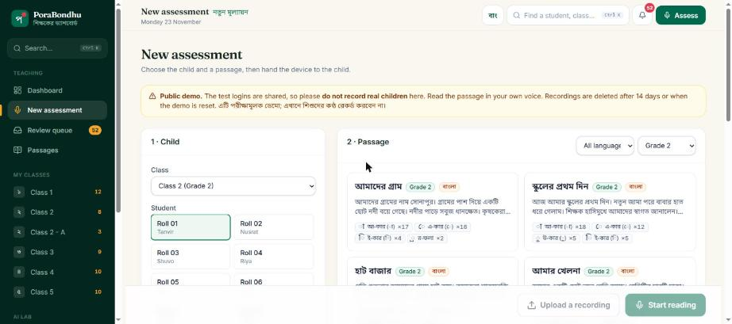<br><sub>9. New assessment: child and passage</sub></td><td width="50%" valign="top">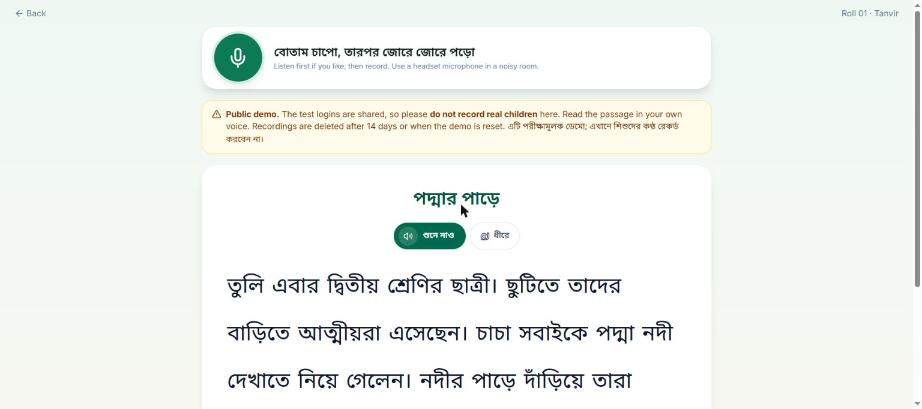<br><sub>10. Reading screen (faces the child)</sub></td></tr>
<tr><td width="50%" valign="top">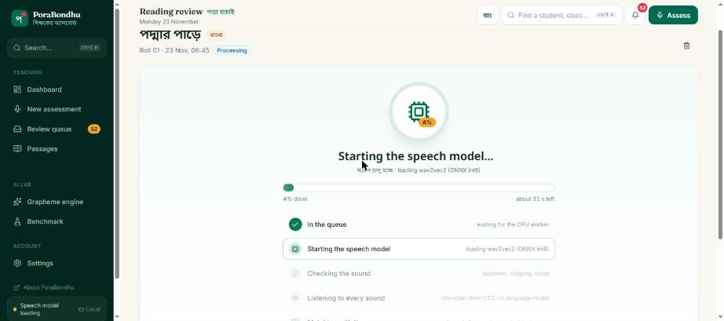<br><sub>11. Marking: starting the speech model</sub></td><td width="50%" valign="top"><br><sub>12. Marking: listening to every sound</sub></td></tr>
<tr><td width="50%" valign="top">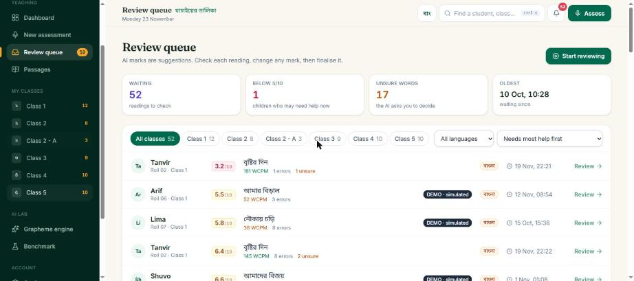<br><sub>13. Review queue</sub></td><td width="50%" valign="top"><br><sub>14. Review a reading</sub></td></tr>
<tr><td width="50%" valign="top">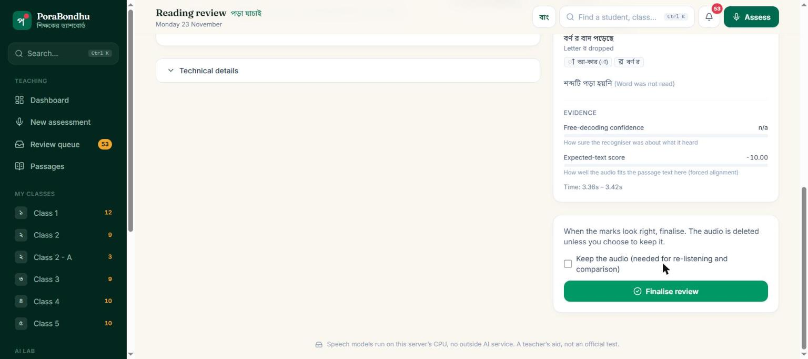<br><sub>15. Finalise (audio deleted unless kept)</sub></td><td width="50%" valign="top">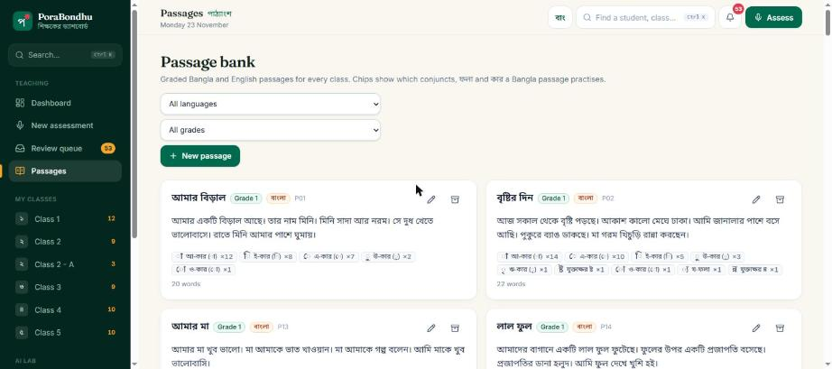<br><sub>16. Passage bank with unit chips</sub></td></tr>
<tr><td width="50%" valign="top"><br><sub>17. Benchmark</sub></td><td width="50%" valign="top"><br><sub>18. Settings: learning, privacy, password</sub></td></tr>
</table>

</details>

<details>
<summary><b>Student site, all 8 steps</b></summary>

<table>
<tr><td width="50%" valign="top">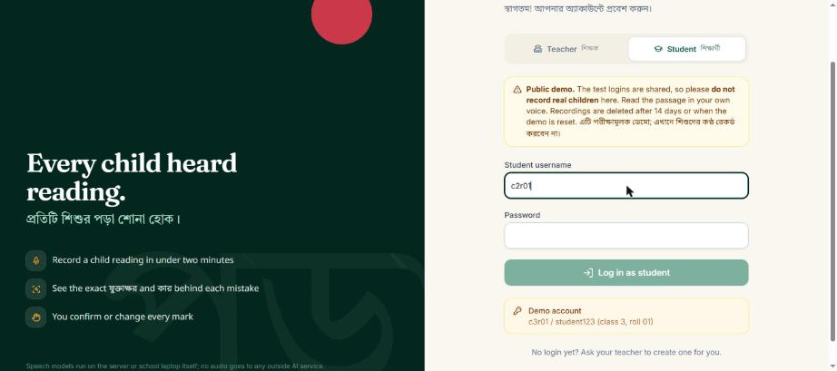<br><sub>1. Student login</sub></td><td width="50%" valign="top">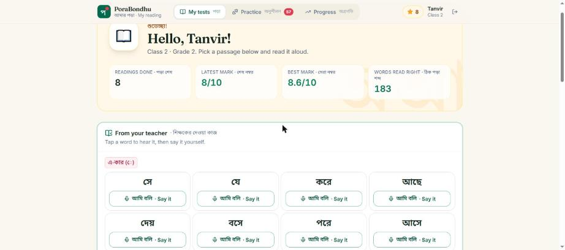<br><sub>2. Home: marks and "From your teacher"</sub></td></tr>
<tr><td width="50%" valign="top">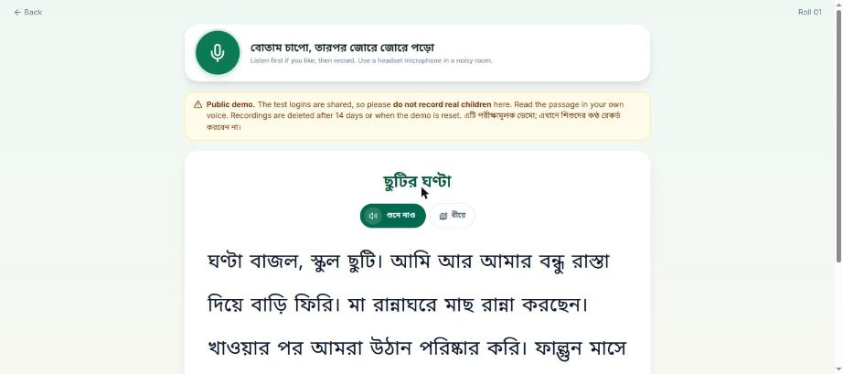<br><sub>3. Read a passage</sub></td><td width="50%" valign="top"><br><sub>4. Waiting for the teacher (no mark yet)</sub></td></tr>
<tr><td width="50%" valign="top">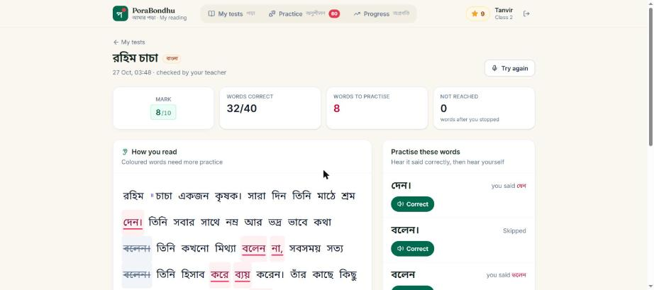<br><sub>5. After the teacher checked it</sub></td><td width="50%" valign="top">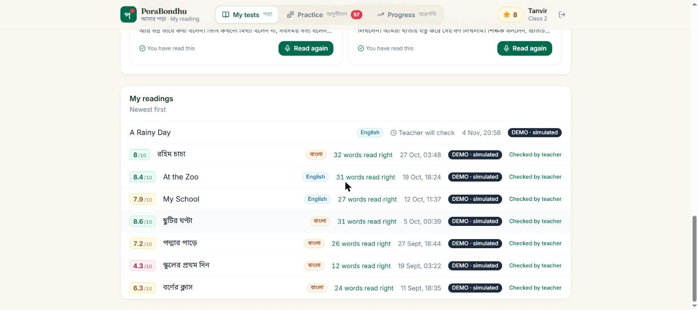<br><sub>6. My readings</sub></td></tr>
<tr><td width="50%" valign="top">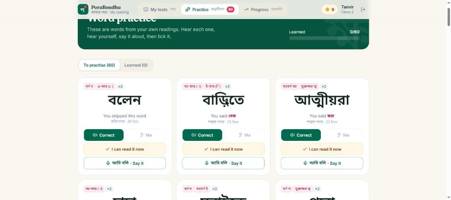<br><sub>7. Word practice with Say it</sub></td><td width="50%" valign="top">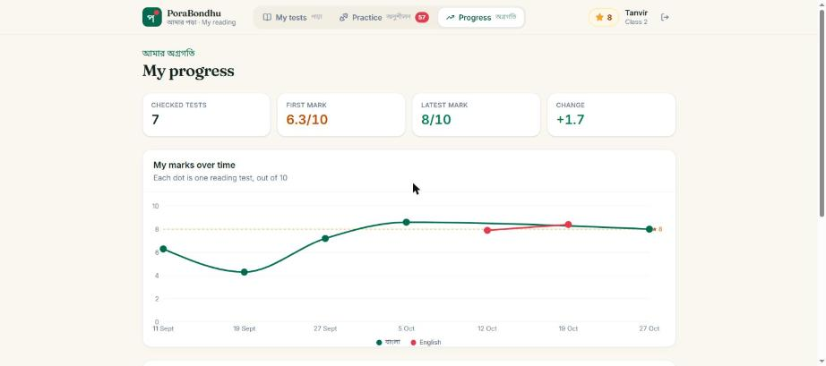<br><sub>8. My progress</sub></td></tr>
</table>

</details>

<details>
<summary><b>Admin: creating teacher accounts</b></summary>

<table>
<tr><td width="50%" valign="top">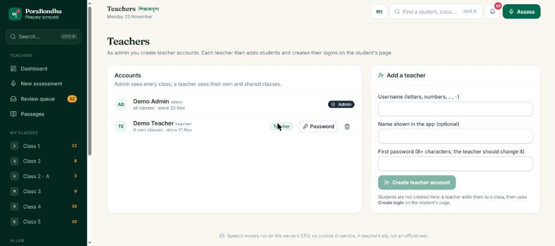<br><sub>Admin → Teachers: create teacher accounts, reset passwords, remove; teachers create student logins on each student's page</sub></td></tr>
</table>

</details>

## Problem

**In one sentence:** Bangladeshi primary teachers know that about half of their pupils cannot read
Bangla at grade level, but they have no quick way to hear each child read and find out *which*
letters and conjuncts that child is stuck on, so the help they give is not targeted.

| # | Evidence (sources opened and checked) | What it means |
|---|---|---|
| 1 | **51%** of 10-year-olds could not read and understand a simple text in 2022 (World Bank, *Human Capital Complementary Indicators: Bangladesh*, 2025, [PDF](https://thedocs.worldbank.org/en/doc/24459fe03f47e132c41e1e9823b1c765-0140012025/original/Bangladesh.pdf)) | The problem is large and national |
| 2 | National Student Assessment 2022: **54,232** pupils in Grades 3 and 5; **about 50%** at grade level in Bangla (DPE/UNICEF, presented by ACER, [slides](https://neqmap.bangkok.unesco.org/wp-content/uploads/2024/01/Session-3-Priyanka-Sharma.pdf)) | Half of each class is behind |
| 3 | That assessment is **pen-and-paper and system-level**, run every few years (same source) | It counts *how many* struggle; it never listens to a child read and never tells a teacher *why* |
| 4 | Fluency benchmark **45 words per minute by end of Grade 2**; Bangla vowel signs and conjunct letters make it harder (Room to Read, 2017, [page](https://www.roomtoread.org/the-latest/benchmarking-reading-fluency-in-bangladesh/)) | Reading must be checked by listening; কার and যুক্তাক্ষর are the hard units |
| 5 | **1 teacher per 28 pupils** in government primary schools, 2023 average (*The Daily Star*, 2025, [article](https://www.thedailystar.net/opinion/views/news/bangladesh-needs-better-education-infrastructure-prevent-primary-dropouts-3977821)) | At ~3 min per child (our estimate), one listening round takes ~84 min, 2+ periods, more in crowded classes |

**Not yet confirmed:** no teacher has been interviewed about this tool. The evidence shows the problem
exists; whether teachers want *this* solution is still open. Full evidence chain, the time
calculation and a 10-minute teacher interview script: [docs/PROBLEM_EVIDENCE.md](docs/PROBLEM_EVIDENCE.md).

## Solution

1. **Listen.** The child reads a short graded passage aloud in the browser.
2. **Mark.** A character-level Bangla speech model (no language model, so it does
   not "fix" the child's mistakes) transcribes the reading, and our alignment
   engine marks every word: correct, misread, skipped, repeated, hesitated or unsure.
3. **Diagnose.** Each error is traced to the written unit behind it (যুক্তাক্ষর,
   কার, র-ফলা, য-ফলা, রেফ, চন্দ্রবিন্দু). Repeated errors become candidate weak patterns.
4. **Inform the teacher.** Speed (WCPM), accuracy, a mark out of 10, weak
   patterns, practice words and a class pattern map. The teacher confirms or
   corrects any mark with one tap and has the final word.

## Features

* Teacher and student logins; classes and students by roll code (no names stored)
* In-browser recording (16 kHz WAV) with an audio quality check
* Marked passage with a per-word inspector: heard vs expected unit by unit,
  Bangla diagnosis, both confidence signals, and playback of just that word
* Student progress (WCPM and accuracy over time), weak patterns, practice suggestions
* Class pattern map: which units most children misread
* "Listen first" model reading for students (neural TTS, word highlighting)
* Side-by-side comparison with Whisper and plain CTC on the same audio
* Live grapheme engine page (normaliser, segmenter, unit diff)
* English passages (marked by Whisper) next to Bangla
* Evaluation scripts: calibration on tuning speakers, benchmark with 95% CIs
* **Three roles:** an admin creates teacher accounts (**Teachers** page), each teacher creates the
  logins of their own students (student page → **Create login**), students see only their own work.
  See [docs/WALKTHROUGH.md](docs/WALKTHROUGH.md) for every screen.
* **Learns from teacher reviews** (no model retraining, nothing leaves the device): a pronunciation
  teachers accept 3 times for a word becomes an accepted variant, and after 10 reviewed readings the
  marking thresholds are re-tuned to agree with the teachers' final marks (false alarms kept ≤5%,
  one-click undo; Settings → Learning from your reviews)
* **Assign practice** to one child, a weak-pattern group (from the class pattern map) or the
  whole class; the child sees it under "From your teacher" and it is marked done when read
* **Word check** for students: say one practice word and the same speech model checks it at once
  (unclear audio comes back as "try again", never as wrong)
* CSV export of a class (opens in Excel), printable student and class reports
* Bangla / English switch for the teacher interface (navigation, page titles, main buttons)

## Tech stack, models and data

| Part | Technology |
|---|---|
| Frontend | React 19, TypeScript, Vite, Tailwind CSS 4, TanStack Query, Recharts |
| Backend | Python 3.10, FastAPI, SQLAlchemy (SQLite, or PostgreSQL) |
| Speech model | [arijitx/wav2vec2-xls-r-300m-bengali](https://huggingface.co/arijitx/wav2vec2-xls-r-300m-bengali) (Apache-2.0), exported by us to ONNX int8: [safu58/porabondhu-wav2vec2-bn-onnx-int8](https://huggingface.co/safu58/porabondhu-wav2vec2-bn-onnx-int8) |
| Baseline and English | OpenAI Whisper `small` via faster-whisper (CTranslate2, int8) |
| Model reading (TTS) | Microsoft Edge neural voices via edge-tts (passage text only) |
| Team-built AI parts | Bangla normaliser and grapheme segmenter, weighted word/unit alignment, CTC forced alignment and expected-text score, two-signal marking, weak-pattern tracking |
| Passages | 42 Bangla and 25 English graded passages, Grades 1-5. **T01-T12** (`backend/app/seed/textbook_passages.json`) are aligned to the NCTB textbooks *আমার বাংলা বই* (Grades 1-3, 2025 reprint): each practises the কার, ফলা, রেফ or যুক্তাক্ষর of one lesson and cites its page ([evidence table](docs/CURRICULUM_ALIGNMENT.md), checked by `scripts/curriculum_evidence.py`). All passage text is written by the team (AI-assisted); no textbook text is copied |
| Evaluation data | [Google FLEURS](https://huggingface.co/datasets/google/fleurs) Bengali (`bn_in`, CC BY 4.0): real adult read speech; reading errors simulated by changing the expected text (`scripts/make_public_set.py`). Tuning on 120 FLEURS dev recordings, testing on 100 FLEURS test recordings (different sentences; speaker overlap cannot be verified). **No child speech yet** |
| Hosting | The repository's `Dockerfile` (ONNX int8 model, no PyTorch) on a 2-core / 4 GB Ubuntu VPS, behind Caddy with a Let's Encrypt certificate. Backup: the same code on a laptop behind an ngrok tunnel (`deploy/run-public.ps1`) |

## AI tools used

| Tool | What we used it for |
|---|---|
| Claude (Anthropic), through Claude Code | Helping write and review code, tests, scripts and documentation, drafting the textbook-aligned passages T01-T12 (checked by us against the NCTB lessons), and helping with deployment setup. We designed the system and can explain every part |

No language-model API is called by the app itself.

---

## Quick start (Windows)

Requirements: Python 3.10+, Node 20+, ~3 GB free disk, 8 GB+ RAM. ffmpeg is
optional (only for uploading mp3/m4a/webm files; in-app recording does not need it).

```powershell
.\setup.ps1      # venv, CPU PyTorch, model download + ONNX int8 export, tests, frontend build
.\start.ps1      # http://localhost:8000
.\start.ps1 -Dev # backend with reload + Vite dev server on http://localhost:5173
```

Manual steps (any OS):

```bash
cd backend
python -m venv .venv && . .venv/bin/activate        # Windows: .venv\Scripts\activate
pip install torch==2.14.1 --index-url https://download.pytorch.org/whl/cpu
pip install -r requirements.txt
python -m scripts.export_onnx                      # optional but ~2x faster on CPU
python -m pytest -q
uvicorn app.main:app --port 8000

cd ../frontend && npm install && npm run build      # served by the backend at :8000
```

Docker (the same image as the live demo, no PyTorch needed):

```bash
docker build -t porabondhu .
docker run -p 7860:7860 porabondhu   # http://localhost:7860
```

Live demo on a VPS (what the link above runs):

```bash
git clone https://github.com/mohammadyaksafu/porabondhu-ai && cd porabondhu-ai
docker build -t porabondhu .
docker run -d --name porabondhu --restart unless-stopped --memory 2g -p 127.0.0.1:8110:7860 \n  -v porabondhu_data:/home/user/app/backend/data porabondhu
# bound to 127.0.0.1 so only the HTTPS proxy reaches it (the app trusts the proxy's X-Forwarded-For)
docker run -d --name porabondhu-caddy --restart unless-stopped --network host \n  -v $PWD/deploy/Caddyfile:/etc/caddy/Caddyfile:ro -v porabondhu_caddy:/data caddy:2-alpine
```

Backup demo from a laptop (separate demo database on port 8100, ngrok HTTPS tunnel):
`.\deploy\run-public.ps1 -Domain <your-ngrok-domain>` (stop with `-Stop`).
Or push the committed code to a Hugging Face Docker Space (needs a PRO account):
`backend/.venv/Scripts/python deploy/push_space.py`

PostgreSQL instead of SQLite: `docker compose up -d db` and set
`PB_DATABASE_URL` in `backend/.env` (see `.env.example`).

## Using it

1. **Classes** → create a class, add students by roll number (no names stored).
2. **New assessment** → choose child and passage → **Start reading**. The child
   sees only the passage, a big record button and encouragement afterwards.
3. **Review** → the marked passage. Click any word (or use ← → and keys 1-4)
   to see heard vs expected unit by unit, the diagnosis in Bangla, both
   confidence signals, and to listen to just that word. Finalise; audio is
   deleted unless you keep it.
4. **Student page** → WCPM/accuracy over time, grapheme pattern counts,
   candidate weak patterns and practice words/passages from the bank.
5. **Class page** → class pattern map: which units most children misread.
6. **Baseline comparison** on any reading with kept audio runs Whisper and
   plain CTC on the same audio, side by side.
7. **Grapheme engine** page shows the normaliser/segmenter/diff live.

## What is new (and what is not)

The building blocks are known: CTC speech recognition, and forced alignment with a
goodness-of-pronunciation style score (Witt and Young, 2000) are standard in
computer-assisted pronunciation training. Reading tutors and assessment tools for
children exist (for example Google Read Along, Amira Learning), mostly giving
word-level feedback. What PoraBondhu adds, as far as we know, is the combination below for
**Bangla primary reading**:

| | Typical approach | PoraBondhu |
|---|---|---|
| Unit of feedback | Word right or wrong, words per minute | The **Bangla written unit** behind the error (যুক্তাক্ষর, ফলা, রেফ, কার, চন্দ্রবিন্দু), from our own grapheme segmenter and unit diff |
| Recognition | ASR with a language model, which tends to "correct" the child | Character-level CTC with **no language model**, plus a second, independent expected-text score; an error needs both to agree |
| Uncertainty | Forced decision | **Abstention**: "unsure" goes to the teacher and never counts as an error |
| Spelling vs reading | Spelling differences count as errors | Letters that sound the same (স/শ/ষ, ি/ী …) are not reading errors |
| From diagnosis to teaching | Report | Repeated unit errors become weak patterns → class pattern map → **practice assigned to exactly the children who need it**, with passages tied to the **NCTB lesson and page** that teaches that unit |
| Child safety | Score shown at once | Child sees the mark only after the teacher checks it |
| Improvement over time | Fixed model, or retraining on collected audio | **Learns from each teacher review**: replays the stored evidence of every decision to re-tune its thresholds and adopts regional pronunciations teachers accept; transparent and reversible, no audio kept |
| Cost and privacy | Cloud service | Offline on a school laptop CPU, no API cost, no audio leaves the device |

How well this works on children is **not yet known** (see [Evidence still needed](#evidence-still-needed)).

## How the AI works

```
audio ─► quality check ─► wav2vec2 CTC (Bangla, CPU, ONNX int8)
                              │ frame log-probabilities (20 ms)
              ┌───────────────┴────────────────┐
     greedy decoding, no LM            CTC forced alignment of the passage
     (what was actually said,          (expected-text score per unit,
      char confidence, times)           covers skipped units, word times)
              └───────────────┬────────────────┘
        Bangla grapheme engine: normalise → segment into units
        weighted alignment: words (with merge/split) → units
        diagnosis: which reph / phala / conjunct / kar / sign differs
        decision: error | correct | unsure (two signals must agree)
              │
        WCPM, accuracy, hesitation (≥3 s), repetitions, not-reached
        weak patterns = repeated confirmed errors across readings
```

* **Error-preserving recognition.** Character-level CTC with greedy decoding
  has no language model to "fix" the child's mistake into the expected word.
  This is a hypothesis we test against Whisper, not a claim.
* **Two confidence signals.** Free-decoding confidence (mean posterior of each
  emitted character) and an expected-text score (at the frame where the
  passage character is most likely: its log-probability minus the best
  competing character, capped by an absence floor). An error is marked only
  when the decoder confidently heard something else *and* the passage text
  fits the audio poorly; if the passage fits well it is correct; otherwise
  **unsure**, which is shown to the teacher and never counted as an error.
* **Spelling-only differences are not errors.** স/শ/ষ, ি/ী, ু/ূ, ন/ণ, জ/য, ত/ৎ
  sound the same in reading, so a difference only between them is ignored.
  Phonetic similarity is used only to pick the right alignment, never to
  excuse a real substitution.
* **Thresholds** are tuned on tuning speakers only (`scripts/calibrate.py`)
  and saved to `data/thresholds.json`; test speakers are never used for tuning.

## Evaluation

```bash
cd backend
python -m scripts.annotation_template eval/recordings.csv eval/annotations.csv
python -m scripts.calibrate  --recordings eval/recordings.csv --annotations eval/annotations.csv
python -m scripts.benchmark  --recordings eval/recordings.csv --annotations eval/annotations.csv
```

Three systems on the same recordings: Whisper + word compare, Bangla CTC + word
compare, PoraBondhu. Reports recall, precision, false alarms, unsure rate,
grapheme error accuracy, WCPM MAE and Spearman, uncertainty coverage,
CER/WER, Cohen's kappa and processing time, each percentage with counts and a
95% Wilson interval, adults and children separately, plus a pass/fail table
against the success criteria fixed in the proposal. See
[docs/DATA_COLLECTION.md](docs/DATA_COLLECTION.md).

`scripts/make_synthetic_set.py` builds a TTS-generated set **only to check that
the scripts run**. Its numbers are not results and must not be reported.

### Results (published in [`backend/results/EVALUATION.md`](backend/results/EVALUATION.md), shown on the Benchmark page)

**Data:** Google FLEURS Bengali (`bn_in`, CC BY 4.0): native **adults** reading sentences correctly.
Reading errors are **simulated** by changing the expected text the system is given. Thresholds were
tuned on 120 FLEURS *dev* recordings; results are on the first **100 FLEURS *test*** recordings
(1,870 words, 262 simulated errors). FLEURS has no speaker IDs, so speaker separation between dev
and test cannot be verified (the splits use different sentences). Labels are generated, so there is
no inter-annotator agreement. **No child speech and no authentic misreadings are evaluated.**

| System (same audio) | Recall | Precision | False alarms | Unsure |
|---|---|---|---|---|
| **PoraBondhu** | 82.4% (77-87) | **76.1%** (71-81) | **4.2%** (3.3-5.3) | 17.7% |
| Plain CTC + word compare (same speech model, no PoraBondhu layer) | 100% | 27.4% (25-30) | 43.1% (41-46) | 0% |
| Whisper small + word compare | 100% | 14.6% (13-16) | 95.1% (94-96) | 0% |

95% Wilson intervals in brackets. Against plain CTC on the same recordings (paired bootstrap):
precision **+48.6 points** (+44.3 to +52.7), false alarms **-38.9 points** (-42.2 to -35.6), recall
-17.6 points (-22.6 to -12.9), and 17.7% of words are passed to the teacher as "unsure". Whisper
small produced largely unusable Bengali text on this data (character error rate about 80%), so it is
**not a strong baseline**; a larger or Bangla-tuned Whisper was not tested (CPU time).
Our pre-registered hypothesis ("+10 points recall over Whisper") is therefore **not supported** and
not meaningful here. Targets: recall ≥80% met, false alarms ≤5% met, precision ≥80% **missed** (76%),
≤15 s per 60 s reading **missed** (16.2 s on the 4-core laptop).

**Robustness (PoraBondhu only, 100 test recordings each):**

| Check | Recall | Precision | False alarms | Unsure |
|---|---|---|---|---|
| Error types the detector was not designed around (random consonant swaps, real-word substitutions) | 90.2% | 74.3% | 4.2% | 17.6% |
| Real skips (word audio cut out of the recording) | 76.9% | 63.5% | 3.9% | 18.5% |
| Child-like voice by resampling (pitch and formants raised 10-20%; a proxy, not children) | 79.4% | 74.6% | 4.4% | 21.7% |

So the method is not only finding its own perturbation types, and it handles real skips less well
than simulated ones. On the child-like proxy it loses little (paired: recall -3.0 points, -6.3 to
0.0; false alarms +0.2; unsure +4.0 points). A first child-like proxy built with phase-vocoder
pitch shifting looked catastrophic (recall 13%), but a control showed that shifting pitch up and
back down again already drops recall to 23%, so that result measured **processing artifacts, not
voices**; it is kept, labelled as confounded, in [`EVALUATION.md`](backend/results/EVALUATION.md).
A test-time voice-normalisation idea did not help and is not used. Real children's speech (different
pronunciation, hesitations, classroom noise) remains untested.

**Tuning:** 3-fold cross-validation on the dev recordings gave precision 81% ± 2, recall 82% ± 6,
false alarms 3.3% ± 0.4. One threshold (`gop_high` = 0.1) is at the edge of the searched range.

The earlier [10-recording pilot](backend/results/benchmark_pilot_10.md) (PoraBondhu only) is kept for reference.

Measured on the development laptop (Intel i5-10310U, 4 cores, no GPU):
ONNX int8 CTC processes ~14 s of audio in ~4.5 s, i.e. roughly 18-20 s per
60 s reading (target ≤ 15 s; use `PB_TORCH_THREADS` and close other apps).
The PyTorch fp32 path is ~2x slower.

## Scaling and monitoring (local only, not deployed)

> **Not part of the hosted demo.** Prometheus, Grafana and the load test run only on our own laptop. The
> demo VPS (2 cores, ~4 GB RAM) is too small to run them next to the speech model, so there the new
> settings stay at their safe defaults (`PB_METRICS_ENABLED=false` → `/metrics` returns 404,
> `PB_MARKING_WORKERS=1`).

* **Marking queue with workers** (`PB_MARKING_WORKERS`) and a **queue limit** (`PB_MAX_QUEUE`, default
  200): when the queue is full, an upload gets *503, busy, try again in a minute* instead of the server
  falling over.
* **Prometheus `/metrics`** (no extra library): readings marked, marking time, queue wait and length,
  busy workers, audio minutes, API requests. Counts and timings only, never names, text or audio.
* **Grafana dashboard** provisioned by `docker compose -f docker-compose.monitoring.yml up -d`.
* **Load test** (`backend/scripts/loadtest.py`), real FLEURS Bangla recordings sent in bursts, measured
  on 23 Nov 2026 on our laptop with the demo's speech model (ONNX int8, CPU):

| Children pressing "stop" at once | 1 worker: all marked after | 2 workers: all marked after | Failed |
|---|---|---|---|
| 10 | 34 s | 30 s | 0 |
| 25 | 88 s | 76 s | 0 |
| 50 | 268 s | 157 s | 0 |

With 2 workers the laptop marks about **200 one-minute readings per hour** using under 1.6 GB of memory:
enough for a 300-pupil school reading once a week in about 1.5 hours. A 2-core server (measured at about
2× real time) marks about 115 per hour. These are calculations from our measurements, not a school trial.
Full tables, the Grafana screenshot, the school capacity calculation and how to run it:
[docs/SCALING.md](docs/SCALING.md).

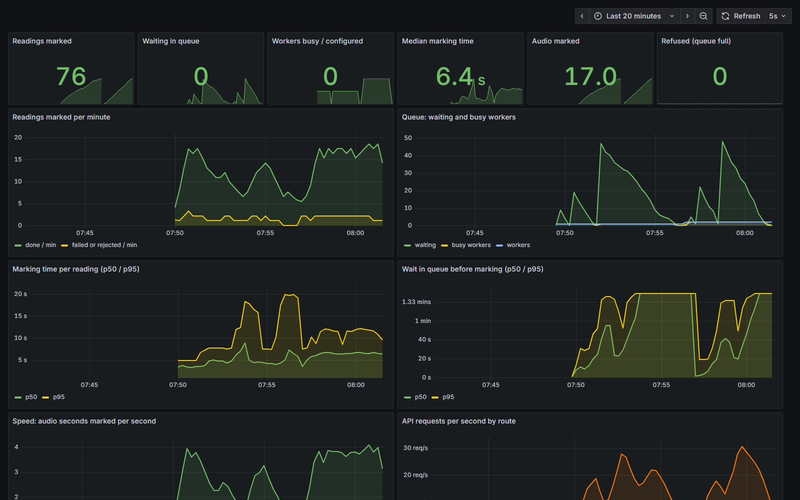

## Child-voice adaptation (optional)

`scripts/adapt_child_voice.py` fine-tunes the top transformer layers on public
adult Bangla speech transformed to sound child-like (pitch shift + vocal tract
length perturbation). `--preview-dir` writes before/after samples to listen to.
Then set `PB_CTC_MODEL_ID` to the output folder and re-run
`scripts/export_onnx.py --model <folder>`. If it does not help on the tuning
speakers, keep the public checkpoint and say so.

## Project layout

```
backend/
  app/
    bangla/        normaliser, segmenter, phonetics + unit diff, pattern labels
    alignment/     weighted edit distance, word (merge/split) and unit alignment
    assessment/    marking rules, metrics (WCPM), weak patterns, word-compare baseline
    speech/        audio I/O + quality check, CTC recogniser (torch/ONNX), Whisper, model registry
    evaluation/    dataset loader, scoring, statistics (Wilson CI, kappa, Spearman)
    services/      reading lifecycle (background worker), analytics/recommendations
    api/           FastAPI routes and serializers
    pipeline.py    one function per system, shared by the app and the benchmark
    models.py      SQLAlchemy tables (SQLite or PostgreSQL)
    seed/          42 Bangla (incl. T01-T12) + 25 English graded passages (Grades 1-5)
  scripts/         export_onnx, calibrate, benchmark, annotation_template,
                   adapt_child_voice, make_synthetic_set, smoke_test
  tests/           engine unit tests
frontend/          React 19 + TypeScript + Tailwind 4 + TanStack Query + Recharts
  src/api/         typed client, types, query hooks
  src/lib/         WAV recorder (AudioWorklet, 16 kHz), formatting
  src/components/  UI primitives, layout, domain chips
  src/features/    classes, students, assess (+ child view), review, passages,
                   engine, benchmark, settings
```

## Privacy and safety

* Students are a roll code and optional nickname; no names, faces or dates of birth.
* **Hosted demo:** recordings travel over HTTPS to our own VPS, are marked there on the
  CPU, and are stored only on that server's disk (Docker volume) until the teacher
  finalises the review. No audio or text is sent to any third-party AI or analytics
  service; the only outside call is Microsoft Edge TTS for the *passage text* of the
  "Listen first" model reading. The demo uses public test logins, so do not record
  real children on it.
* Audio is kept only until the teacher finalises the review, unless they keep it.
* The child sees a mark out of 10 and the words to practise **only after the teacher has
  checked the reading** (enforced by the API, not only the screen). Before that the child
  sees "your teacher will check your reading". Stars reward effort (readings finished,
  words practised), never rankings against other children.
* Recordings are deleted when the teacher finalises a review, and automatically after
  `PB_AUDIO_RETENTION_DAYS` (default 14, failed readings included); recordings the teacher
  chose to keep expire after `PB_KEPT_AUDIO_DAYS` (default 90).
* Each teacher sees only the classes they created (plus shared classes such as the demo ones).
* Per-login limits: 30 reading uploads and 60 word checks per 10 minutes. The word check only
  accepts the child's assigned or teacher-checked practice words and is labelled a practice hint.
* Children never see raw technical errors, only a calm "read again / ask your teacher" message.
* A login is locked for 10 minutes after 5 wrong passwords. Teachers change their own
  password in Settings (8+ characters), which logs that account out on every other device;
  a teacher resetting a child's password also logs the child out and unlocks the login.
  Sessions are server-side (only a hash of the cookie is stored), HttpOnly, and Secure over HTTPS.
* The demo server has a **Reset demo recordings** button so the next visitor never hears
  someone else's voice.
* **Not yet in place for real children** (see the safeguards list in
  [docs/CLASSROOM_AND_PILOT.md](docs/CLASSROOM_AND_PILOT.md#7-safeguards-required-before-any-real-child-pilot)):
  written parental consent forms, an ethics or head-teacher approval, encryption of the audio
  folder at rest, and a named person responsible for the data. We have not recorded any child.
* The teacher has the final word on every mark. PoraBondhu is a teacher's aid,
  not a validated assessment instrument.

## Evidence still needed

What exists today is a working, tested prototype; these claims are **not** yet supported:

| Claim | Evidence needed |
|---|---|
| Accurate on children's reading | Consent-based child recordings, two independent annotators, results reported separately from adults. A resampled child-like voice proxy costs only ~3 points of recall, but a proxy cannot show how real children read |
| Teachers can use it unaided | The [usability test](docs/USABILITY_TEST.md) with at least 5 teachers, task success and SUS reported |
| Teachers want it / it saves time | At least 2 real teacher interviews ([script](docs/PROBLEM_EVIDENCE.md#5-what-is-still-missing-confirmation-from-teachers)), quoted with permission |
| Works in schools | A [pilot](docs/CLASSROOM_AND_PILOT.md#4-pilot-plan-8-weeks-proposed) (proposed only) meeting every safeguard |
| Runs on school laptops | Timing on actual school hardware. So far measured on our 4-core laptop (~18-20 s per 60 s reading) and a 2-core server (8.2-8.4 s per 16.2 s of audio, i.e. ~31 s per 60 s; works with networking switched off) |

## Limitations

* The CTC model can still miss or invent errors; uncertain cases are shown as unsure.
* All evaluation so far uses adult speech (FLEURS, simulated errors). **No child has been recorded**, so accuracy on children is unknown; a resampled child-like voice proxy lowered recall by about 3 points.
* Regional accents may appear as errors until added as accepted variants.
* Whisper `small` often writes Bangla in Devanagari; the baseline maps it back
  to Bengali script by Unicode block offset before comparing.

## Credits and third-party components

* Speech model: [arijitx/wav2vec2-xls-r-300m-bengali](https://huggingface.co/arijitx/wav2vec2-xls-r-300m-bengali) (Apache-2.0), built on Meta XLS-R; our ONNX int8 export is redistributed under the same licence.
* Evaluation data: [Google FLEURS](https://huggingface.co/datasets/google/fleurs) (Conneau et al., 2022), CC BY 4.0.
* Deployment: [Caddy](https://caddyserver.com) (Apache-2.0) with Let's Encrypt; [sslip.io](https://sslip.io) for the hostname; ngrok for the laptop backup.
* Baseline: OpenAI Whisper via [faster-whisper](https://github.com/SYSTRAN/faster-whisper).
* Libraries: PyTorch, Hugging Face Transformers, ONNX Runtime, FastAPI, SQLAlchemy,
  librosa, SciPy, React, Vite, Tailwind CSS, TanStack Query, Recharts, lucide-react,
  Noto Sans Bengali and Inter fonts (Fontsource).
* Synthetic smoke-test audio (not results): Microsoft Edge neural TTS via edge-tts.
* AI coding assistant: Claude (Anthropic) was used to help write code and docs.

## Logins, English reading and marks

**Two roles.** Every page needs a login. On the first start (while the users table is empty) the app seeds demo accounts:

| Role | Username | Password | Can do |
|---|---|---|---|
| Teacher | `teacher` | `teacher123` | everything: classes, students, passages, assessments, review |
| Student | `c1r01` … `c5r10` (class N, roll NN) | `student123` | take reading tests for their own grade, see their own marks |

It also creates `Class 1` … `Class 5` (one per grade) with ten students each. A teacher can create, change or remove a student's login on that student's page. Change the demo passwords before real use, or set `PB_SEED_DEMO=false`.

**English.** Each grade has Bangla passages (`P01`–`P30`) and English passages (`E01`–`E25`). English readings are marked by Whisper in English (greedy decoding, no carried-over context) plus a letter-distance word alignment. The grapheme engine, weak-pattern analysis and system comparison stay Bangla-only.

**Marks.** Every reading test gets a mark out of 10: words read correctly ÷ words in the passage × 10, to one decimal. Skipped, misread and not-reached words earn nothing, and unsure words count as correct (same as accuracy, see `PB_COUNT_UNSURE_AS_CORRECT`). The mark updates when the teacher corrects a word.
