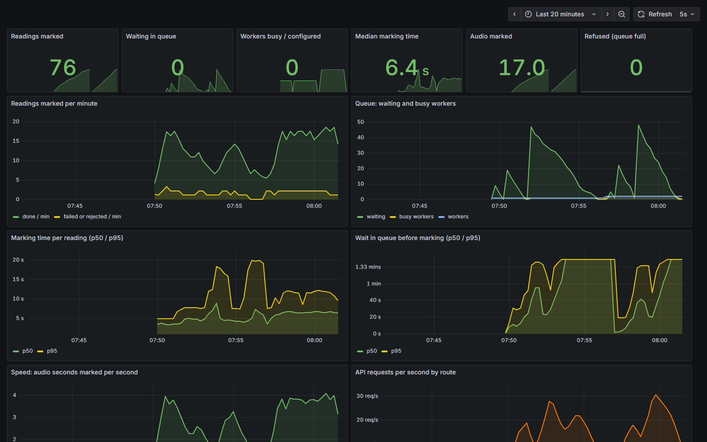

# Scaling and monitoring

> **Local only.** Everything on this page was built and measured on the author's laptop. None of it runs
> on the hosted demo: the demo server (2 cores, about 4 GB RAM, already shared with the speech model)
> has no room for Prometheus and Grafana, and the extra settings stay at their safe defaults there
> (`PB_METRICS_ENABLED=false`, `PB_MARKING_WORKERS=1`). The `/metrics` page returns 404 on the demo.

## 1. What was added

| Part | What it does | Where |
|---|---|---|
| **Marking queue with workers** | Recordings wait in a queue and are marked by `PB_MARKING_WORKERS` threads (default 1). More workers or more servers = more readings per hour, no code change | `backend/app/services/readings.py` |
| **Queue limit** | At most `PB_MAX_QUEUE` readings (default 200) may wait. Beyond that an upload gets **HTTP 503 "busy, try again in a minute"** with `Retry-After`, so an overloaded server slows down politely instead of falling over | same; tested in `tests/test_scaling.py` |
| **Prometheus `/metrics`** | Readings marked, rejected, failed; marking time; time waiting in the queue; queue length; busy workers; audio minutes; API requests by route. **Counts and timings only: no names, no passage text, no audio** (a test checks this). No extra library | `backend/app/metrics.py` |
| **Grafana dashboard** | 12 panels, provisioned automatically | `monitoring/`, `docker-compose.monitoring.yml` |
| **Load test** | Sends 10, 25 and 50 real recordings at the same moment and measures how long until all are marked, plus server CPU and memory | `backend/scripts/loadtest.py`, results in `backend/results/loadtest_1w.json`, `loadtest_2w.json` |

## 2. Load test results (measured on 23 Nov 2026)

**Setup:** server and load generator on the same laptop (8 logical cores, 16 GB RAM, Windows 10), the same
speech model as the demo (wav2vec2 Bangla, ONNX int8, CPU only). Audio: 10 real Bangla recordings from
Google FLEURS (adult speech, about 12 s each), cycled. Each burst = that many children pressing "stop" at
the same moment. 1 in 10 recordings is refused every time by the audio-quality check (always the same
recording); those count as "rejected", not as failures. **No reading failed and no upload was refused.**

| Workers | Burst | Marked | All marked after | Wait until marks (median / 95%) | Marking time per reading (median) | One-minute readings per hour* | Server CPU (mean, all cores) | Server memory (max) |
|---|---|---|---|---|---|---|---|---|
| 1 | 10 | 9 | 34 s | 17 s / 31 s | 3.3 s | ~193 | 48% | 1.0 GB |
| 1 | 25 | 22 | 88 s | 37 s / 81 s | 3.6 s | ~176 | 46% | 1.4 GB |
| 1 | 50 | 45 | 268 s | 140 s / 255 s | 4.9 s | ~121 | 45% | 1.3 GB |
| 2 | 10 | 9 | 30 s | 14 s / 27 s | 6.2 s | ~218 | 49% | 1.2 GB |
| 2 | 25 | 22 | 76 s | 39 s / 71 s | 6.5 s | ~205 | 51% | 1.6 GB |
| 2 | 50 | 45 | 157 s | 81 s / 147 s | 6.8 s | ~206 | 53% | 1.6 GB |

\* Audio seconds marked per wall-clock second × 60, i.e. how many **60-second** readings this machine can
mark in an hour at that load. (The test clips are ~12 s; a real classroom reading is ~1 minute.)

What it shows:

* **A whole class at once works.** 25 children finishing together: every reading marked within about
  1.5 minutes; the queue simply drains.
* **50 at once still works, just slower** (all marked within 2.6-4.5 minutes). Nothing failed and memory
  stayed under 1.6 GB.
* **Two workers help under heavy load** (50 at once: 268 s → 157 s, about 1.7× faster), although each
  reading takes longer because two recordings share the CPU. With one worker the 50-reading run slowed
  down (4.9 s per reading vs 3.3 s), probably because the laptop was also running Docker; with two
  workers throughput stayed steady at ~206 one-minute readings per hour.
* The speech model uses about half of the laptop's logical cores, so the next step up is more machines,
  not more threads.



*Grafana during both runs (1 worker 07:49-07:57, 2 workers 07:58-08:01). In this run the queue-wait
histogram topped out at 89 s, so the "wait in queue" p95 line is flat at its cap; larger buckets were added
afterwards.*

## 3. What this means for schools (calculation from the measurements)

Assume each child reads one 1-minute passage per week.

| Deployment | Capacity (from the table) | Children served at one reading a week |
|---|---|---|
| **One school laptop, offline** (like the test laptop, 2 workers) | ~200 one-minute readings per hour | A 300-pupil school needs ~1.5 hours of marking per week, which fits in the background of a school day |
| **One small server** (2 cores / 4 GB, like our demo VPS; measured earlier at 8.2 s per 16.2 s of audio, ≈2× real time) | ~115 one-minute readings per hour | ~900 children per 8-hour day; about 4,500 per school week |
| **More servers** | Grows with the number of servers (the marking queue does not share state between readings) | A shared database (PostgreSQL is supported via `PB_DATABASE_URL`) and a load balancer in front |

These are calculations from the load test, not a field trial. Real school laptops may be slower; the
measured 2-core server figure is the safer number to plan with.

**Running cost:** no paid API. The only costs are the device (a laptop the school may already have) or a
server's monthly rent, and electricity. The cost per reading is therefore the server rent divided by the
readings it marks; at the measured rate a single small server marks a few thousand readings a week.

## 4. Run it yourself (Windows, about 15 minutes)

```bat
:: 1) PoraBondhu with metrics on, on port 8200 (uses a separate database; deletes what it creates)
cd backend
set PB_METRICS_ENABLED=true& set PB_MAX_UPLOADS_PER_10MIN=0& set PB_MARKING_WORKERS=2
set PB_DATABASE_URL=sqlite:///C:/temp/pb_loadtest.db
.venv\Scripts\python.exe -m uvicorn app.main:app --host 127.0.0.1 --port 8200

:: 2) Prometheus + Grafana (Docker Desktop), from the repository root
docker compose -f docker-compose.monitoring.yml up -d
::    Grafana: http://localhost:3000  ·  Prometheus: http://localhost:9090

:: 3) the load test (needs the FLEURS recordings from scripts/make_public_set.py)
.venv\Scripts\python.exe -m scripts.loadtest --url http://127.0.0.1:8200 --burst 10 25 50 --server-pid <PID of step 1>
```

The load test refuses any address other than `127.0.0.1`/`localhost`, so it cannot be pointed at the
hosted demo by mistake.

## 5. Built since: schools and the district view

Admin → schools → teachers → classes, and a district view (role `district`) that shows which written
units children misread most, school by school, with practice passages, a school × unit table, a weekly
trend and a CSV, all from teacher-checked readings, counts only, groups under 5 children hidden. It is a
normal app feature (no extra service), so unlike Prometheus/Grafana it can run on the small demo server.
See [WALKTHROUGH.md Part 3](WALKTHROUGH.md#part-3--district-view-district-officer-or-admin).

## 6. Not built yet (next steps)

| Step | Why |
|---|---|
| Offline laptop that sends only anonymous pattern counts when online (no audio, no names) | Fits schools with poor internet and keeps children's data on the school laptop |
| Load test on a real school laptop and on a 4-core server | The numbers above are from one developer laptop |
| Separate marking workers in their own processes or machines (e.g. a job table in PostgreSQL) | Today the workers are threads inside the web server; that is enough for one school or one small server |
