# PoraBondhu walkthrough: teacher site and student site

Screenshots taken on 23 Nov 2026 from the app running locally with the demo data. Readings marked
**DEMO · simulated** are generated practice history (scripted errors run through the real marking
engine, no audio), so the screens are not empty; every reading you record yourself is marked live by
the speech model. Demo logins: admin `admin` / `admin123`, teacher `teacher` / `teacher123`, district officer `district` / `district123`, student `c2r01` / `student123`.

---

## Part 0 · Accounts and roles

| Role | Who creates the account | Where | Sees |
|---|---|---|---|
| **Admin** | Created once at installation: `python -m scripts.create_teacher <name> --admin` (demo: `admin` / `admin123`) | Logs in on the **Teacher** tab | Every class, plus **Teachers** in the menu |
| **Teacher** | The admin: **Teachers → Add a teacher** (username, name, first password of 8+ characters) | **Teacher** tab | Their own classes and shared classes |
| **Student** | The teacher: open the class → **Add students** → open a student → **Student login → Create login** | **Student** tab | Only their own readings, marks (after review) and practice |
| **District officer** | The admin: **Teachers → Add an account → Account type: District officer** | **Teacher** tab (opens the district view) | Only counts per school (Part 3); never children, readings or recordings |

The admin can also reset a teacher's password (the teacher is logged out everywhere) or remove a teacher
(their classes stay and become shared). On the public demo, the published demo logins cannot be changed
and teacher accounts created by visitors are removed by **Reset demo recordings**.

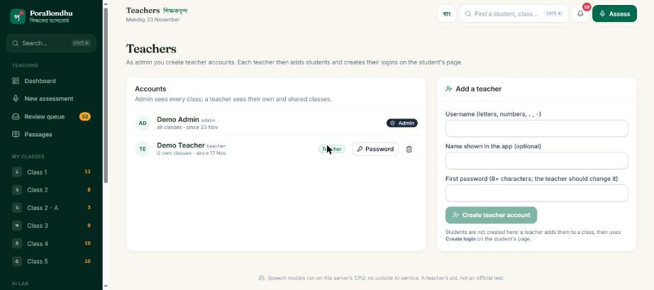

**Schools.** The admin adds schools (name, upazila, district) on **Schools**, and places each teacher in a
school on **Teachers** (their own classes move with them; their new classes join that school). Shared
classes are placed directly under **Classes without a school**. Removing a school removes nothing else.

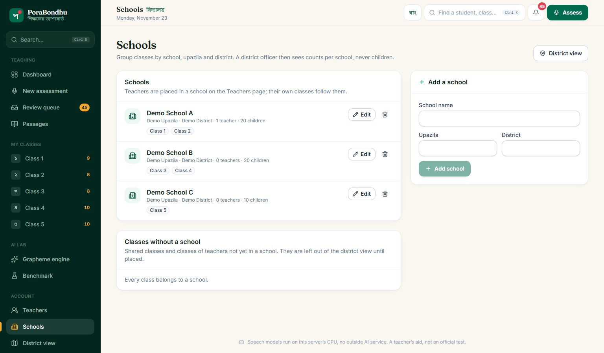
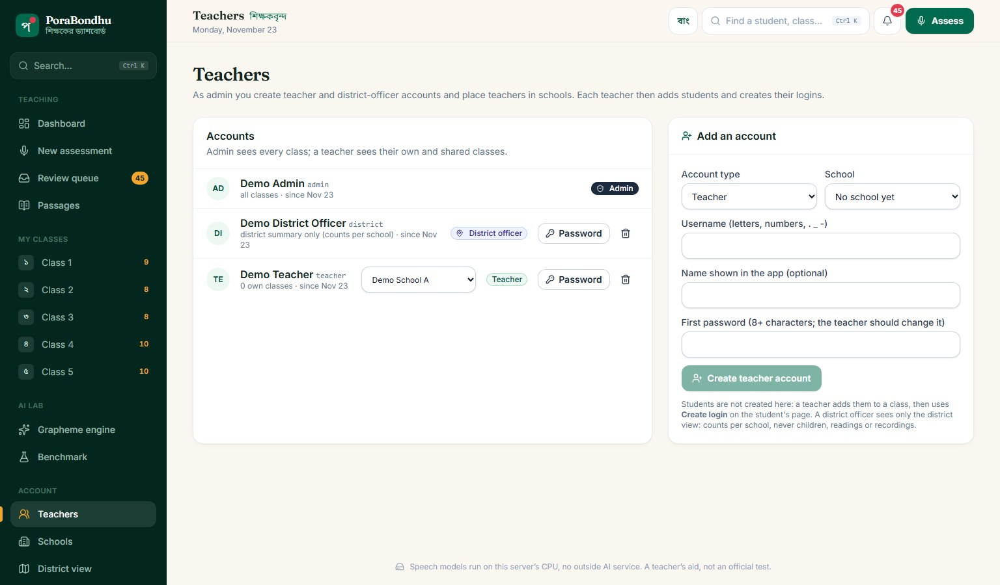

---

## Part 1 · Teacher site

### 1. Log in
Choose **Teacher**, enter the login. The yellow box appears on the public demo only: never record
real children there.

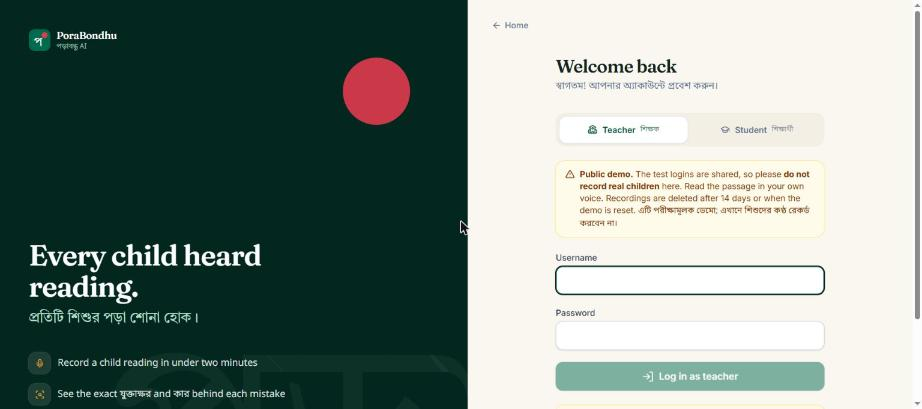

### 2. Dashboard
Classes, students, readings and how many wait for review. The **DEMO** line says how many readings are
simulated. **Start an assessment** is always one click away; **বাং / EN** (top) switches the menus to Bangla.

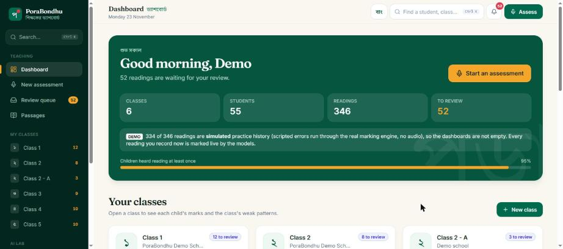

### 3. A class
Each child's latest mark, average, words correct per minute and weak patterns. Buttons: **Export** (CSV
for Excel), **Assign** (practice for the whole class), **Report** (print / PDF), **Add students**,
**Assess a child**.

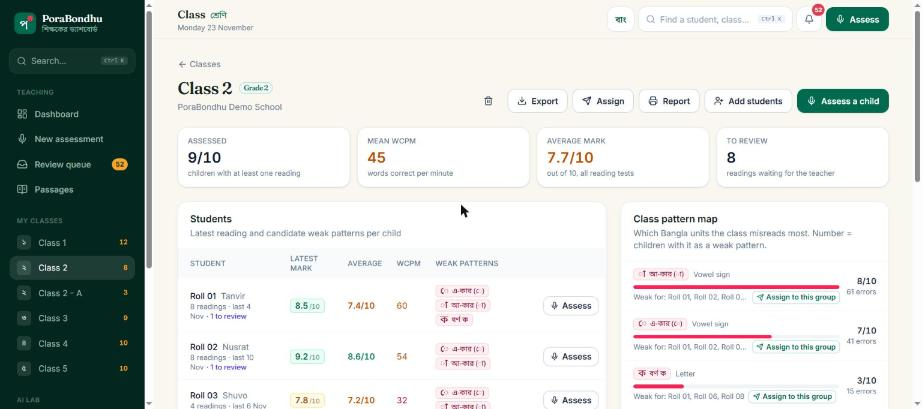

### 4. Class pattern map
Which written units (কার, ফলা, যুক্তাক্ষর, letters) the class misreads most, and for whom.
**Assign to this group** sends practice for that unit to exactly those children.

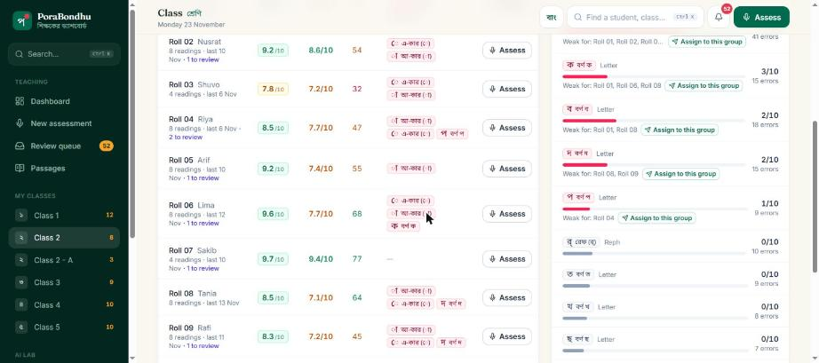

### 5. A student
Marks and reading speed over time, and **What to teach next**: for each weak pattern, practice words and
passages that contain it.

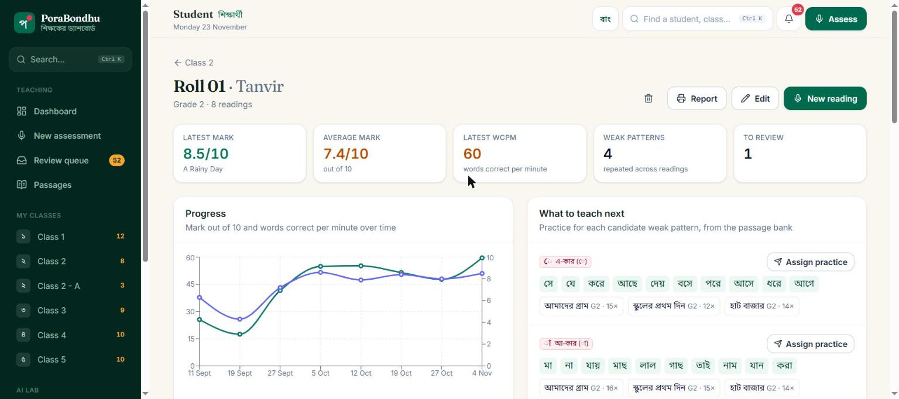

### 6. Practice given, login, grapheme patterns, readings
Below: practice already assigned, the child's login, the transparent error counts per unit (e.g.
"9 errors / 59 seen · 5 readings" with examples like করে → করি), and all readings.

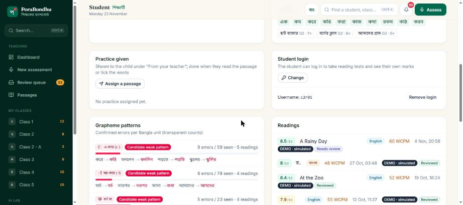

### 7. Assign practice for a weak pattern
**Assign practice** on a pattern: the passage and practice words containing that unit are chosen for you
(or pick a passage), with an optional note to the child.

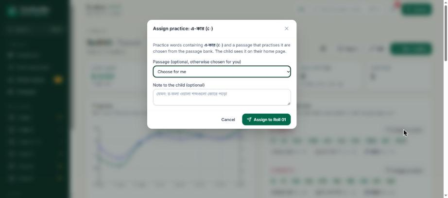
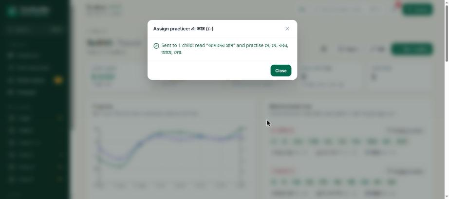

### 8. New assessment
Choose the class, the child and a passage (T01-T12 follow the NCTB textbook lessons), then
**Start reading**, or **Upload a recording**.

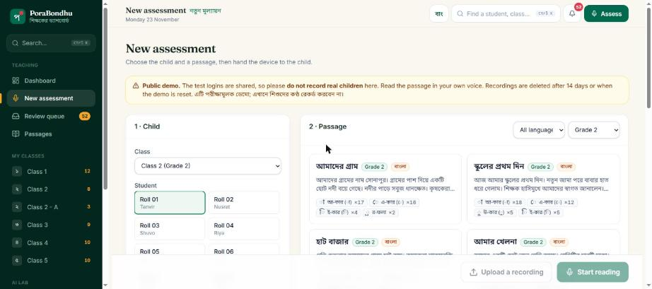

### 9. The reading screen (faces the child)
A big microphone button, the passage in large Bangla type, and **শুনে নাও** to hear it read first. The
child presses the button, reads aloud, and presses stop.

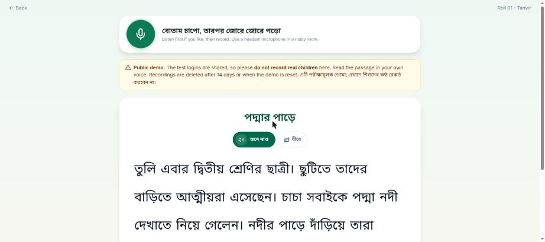

### 10. Marking in progress
The real pipeline stages with a time estimate: starting the speech model (first reading only),
checking the sound, listening to every sound, matching with the passage, finding letter patterns.

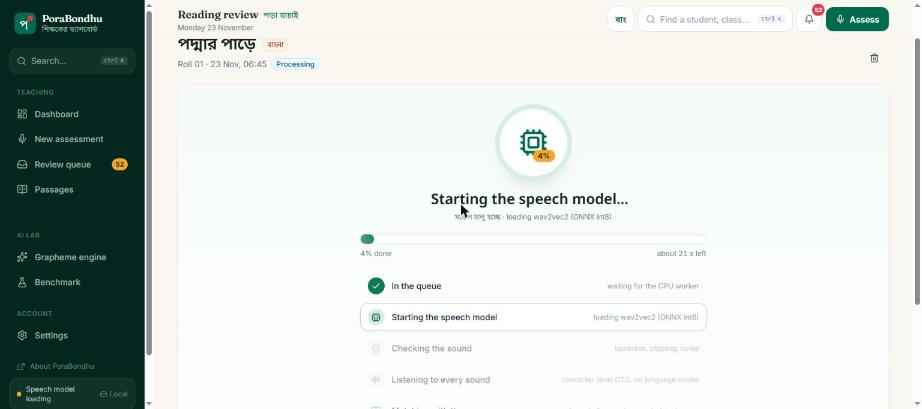
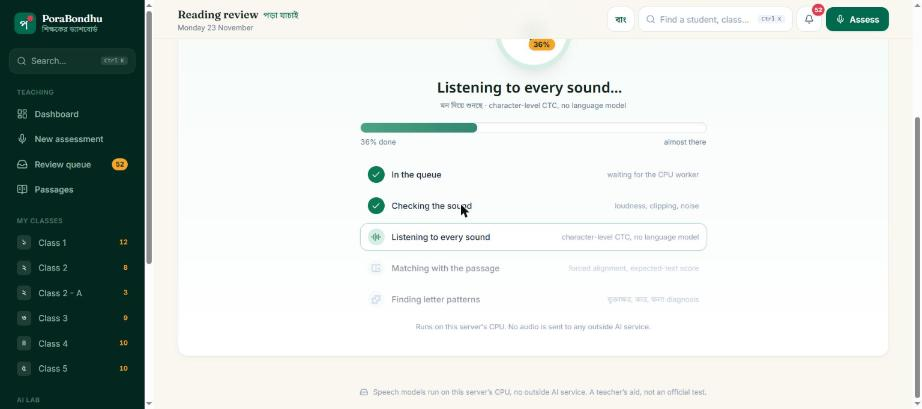

### 11. Review queue
Every reading waiting for the teacher, "needs most help first", with filters by class and language.

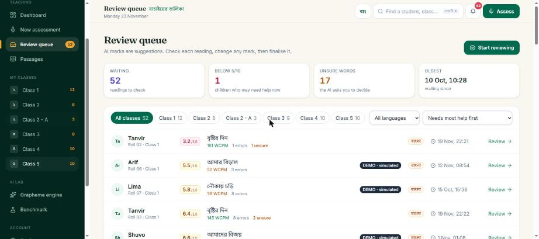

### 12. Review a reading
Mark, words correct per minute, accuracy, errors, **unsure** (never counted as errors). In the passage:
red = misread, struck through = skipped, dotted amber = unsure. Click a word: heard vs expected **unit
by unit**, the diagnosis in Bangla, the evidence, and **Listen** to just that word. Change a mark with
one tap (keys 1-4).

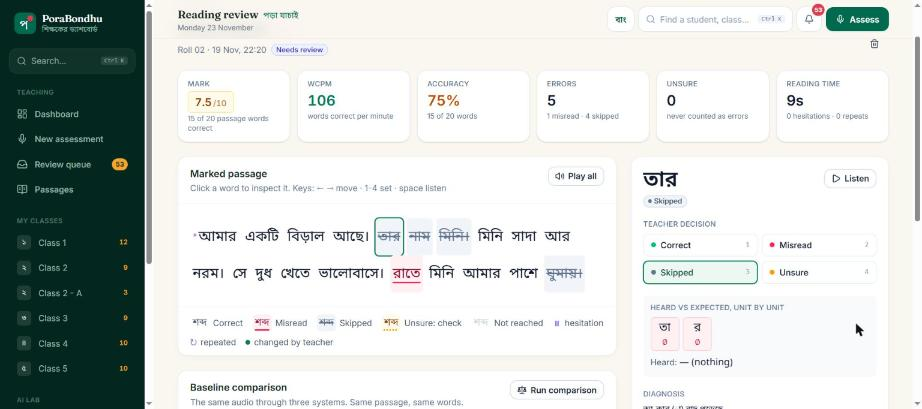

### 13. Finalise
**Finalise review**: the audio is deleted unless "Keep the audio" is ticked. Only now does the child see
the mark, and the corrections teach PoraBondhu (step 16).

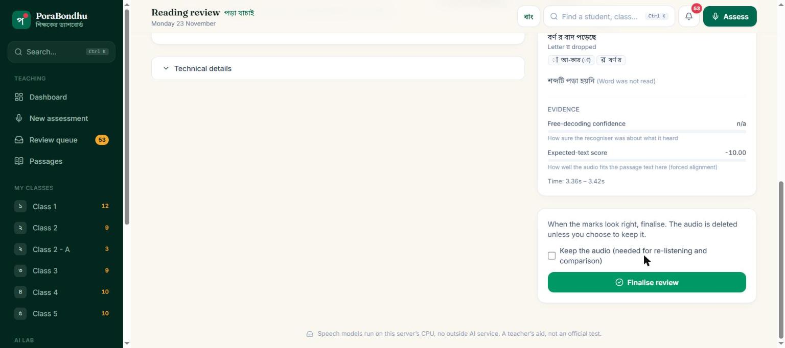

### 14. Passage bank
Graded Bangla and English passages; chips show which units each passage practises.

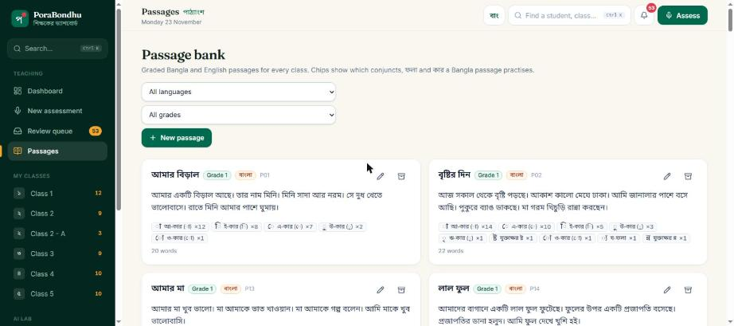

### 15. Benchmark
The held-out evaluation (100 FLEURS test recordings, adult speech, simulated errors): PoraBondhu vs
plain CTC vs Whisper with confidence intervals, the hypothesis we did **not** confirm, robustness checks,
and the targets we miss.

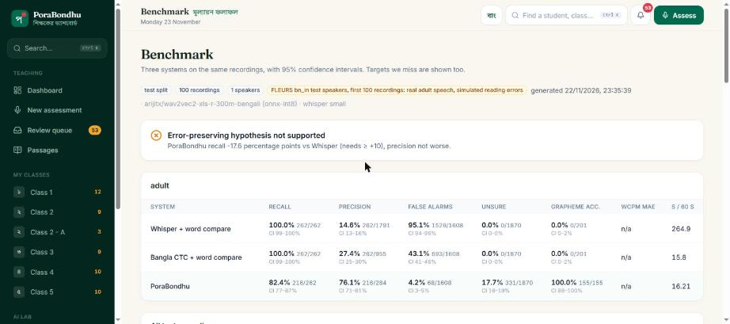

### 16. Settings: learning from your reviews, privacy, password
How many reviews were counted, how often PoraBondhu agrees with you, which pronunciations it learned,
**Learn now** / **Undo**. Below: privacy and safety rules, password change, and (demo only) **Reset demo
recordings**.

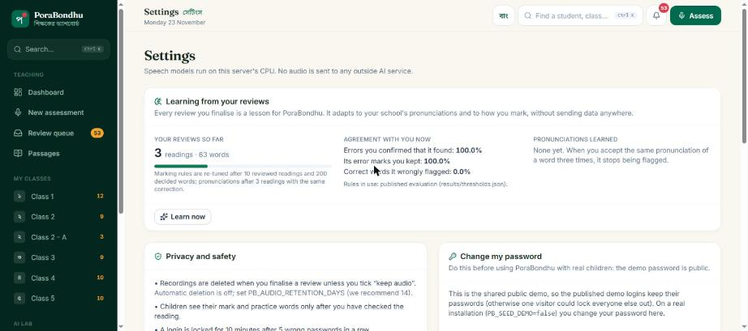

---

## Part 2 · Student site

### 1. Log in
Choose **Student** and enter the child's login (e.g. `c2r01` / `student123`).

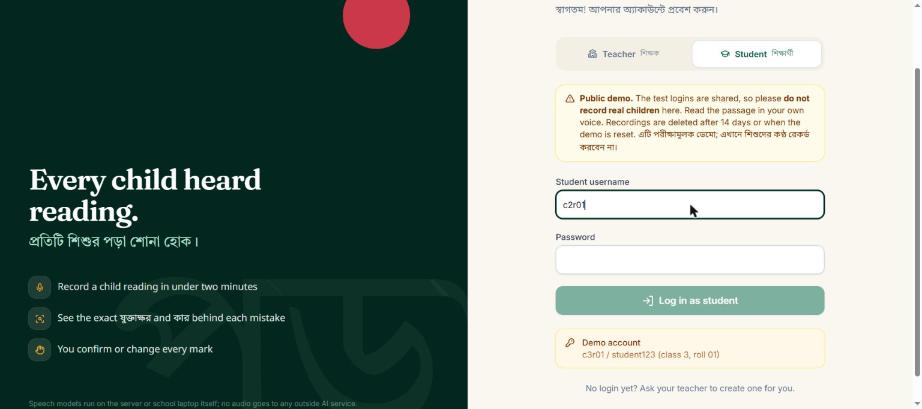

### 2. Home
Readings done, latest and best mark (from teacher-checked readings only), words read right, and
**From your teacher**: the practice the teacher assigned. Tap a word to hear it, then **আমি বলি · Say it**
for an instant practice hint; **Read** opens the assigned passage.

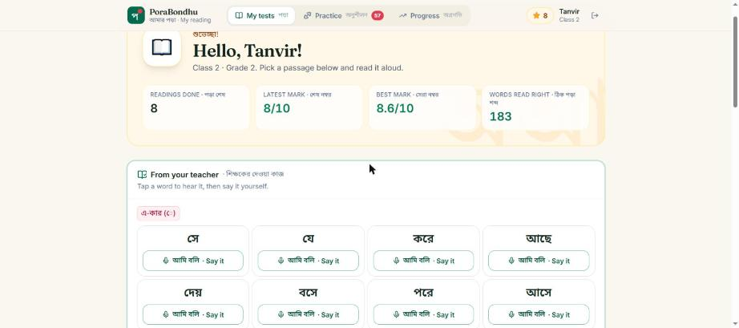

### 3. Read a passage
The same child-friendly reading screen: press the button, read aloud, press stop.

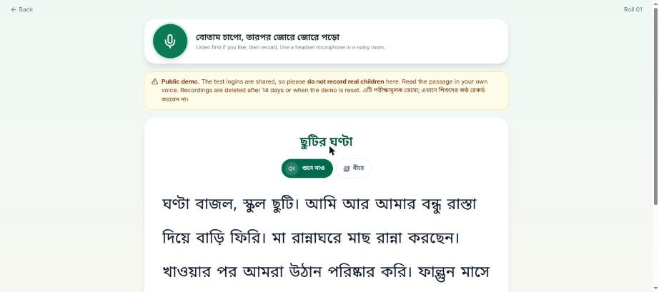

### 4. Waiting for the teacher
Before the teacher checks the reading the child sees **no mark**: "খুব সুন্দর পড়েছ! শিক্ষক এখন তোমার
পড়া শুনবেন।" and can listen to the passage meanwhile.

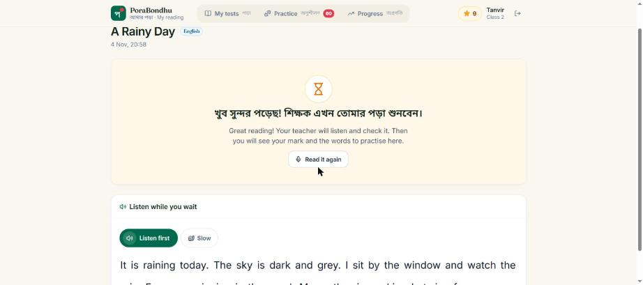

### 5. After the teacher checked it
The mark out of 10, words correct, the passage with coloured words, and **Practise these words** with the
correct pronunciation (and the child's own voice if the teacher kept the audio).

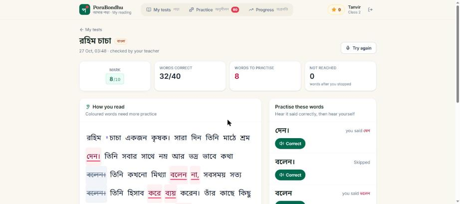

### 6. My readings
Every reading, newest first: checked ones with their mark, unchecked ones "Teacher will check".

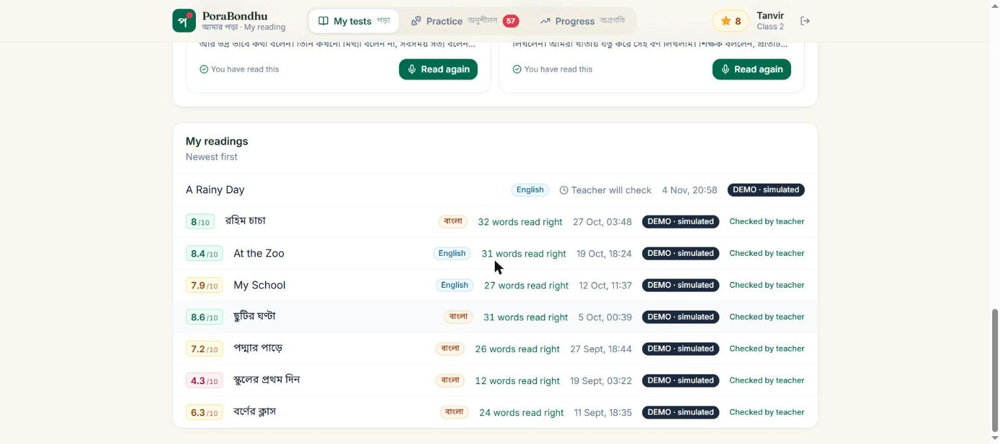

### 7. Word practice
Words from the child's own checked readings: hear it, hear yourself, **Say it** for a practice hint, then
tick **I can read it now**.

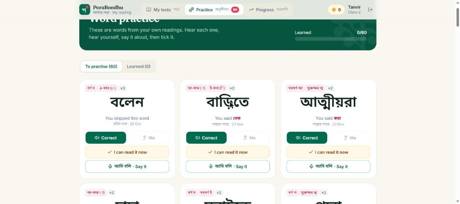

### 8. My progress
Marks over time (Bangla and English) and badges for effort.

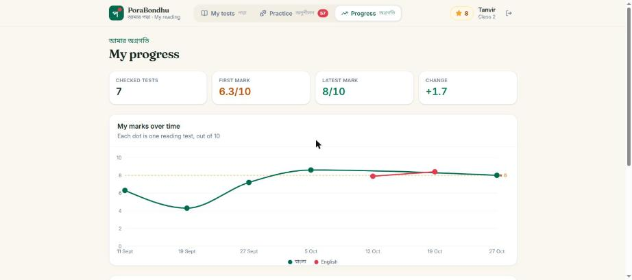

---

## Part 3 · District view (district officer or admin)

Log in on the **Teacher** tab as `district` / `district123` (or open **District view** in the admin menu).
The demo shows three fictional schools with **simulated** practice history, and says so at the top.

### 1. Totals and the hardest units
Schools, children, how many were assessed, teacher-checked readings and the median reading speed. Then the
written units misread most across the district (error rate = misread ÷ times read), how many children
that covers, and the passages (T01-T12 follow NCTB lessons) that practise each unit.

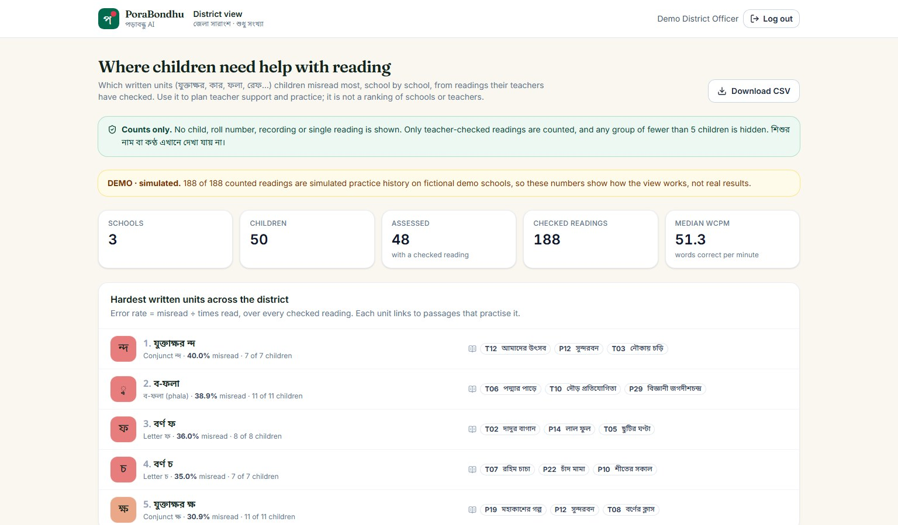

### 2. School × unit
One row per school, one column per kind of unit (যুক্তাক্ষর, কার, ফলা, রেফ, বর্ণ…). Darker = more errors.
A cell read by fewer than 5 children shows "–"; a school with fewer than 5 assessed children shows only
"too few to show".

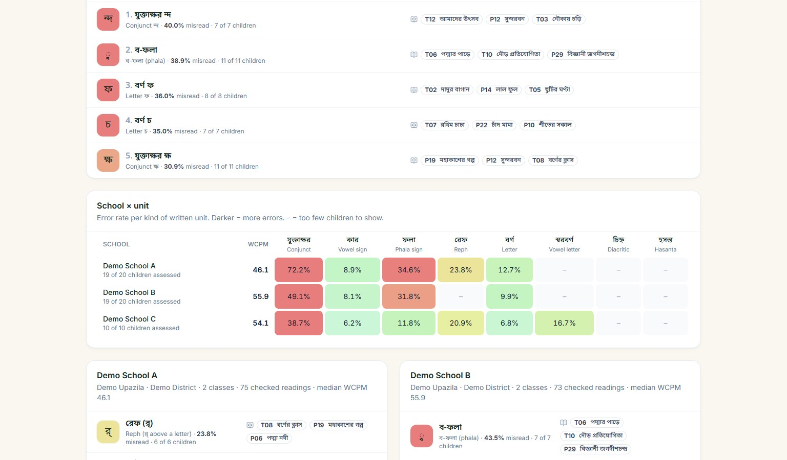

### 3. Each school and the weekly trend
The three hardest units per school with practice passages, and the median words correct per minute by
week (weeks with fewer than 5 children are hidden). **Download CSV** gives the same counts for a
spreadsheet.

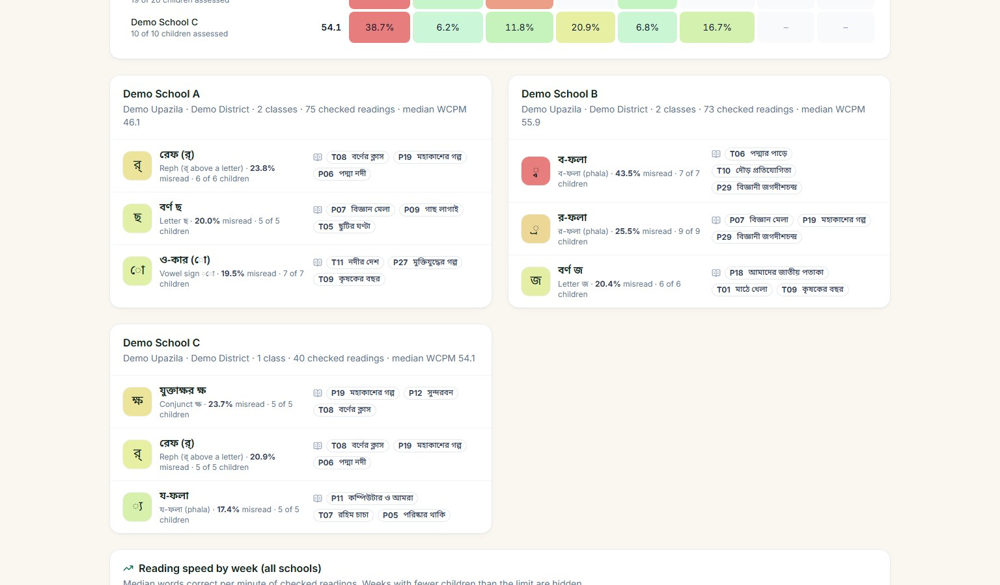
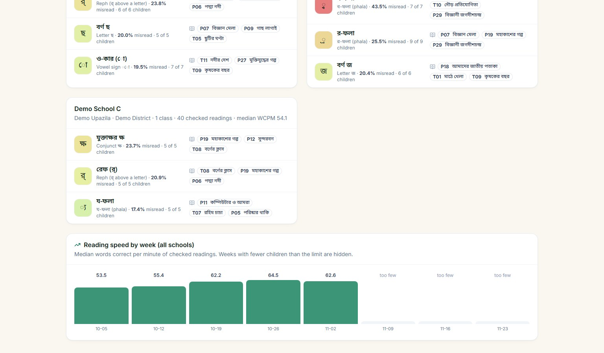

What the officer **cannot** do: open any class, child, reading, recording, the review queue or the admin
pages (the server answers 403; tested in `backend/tests/test_district.py`).
